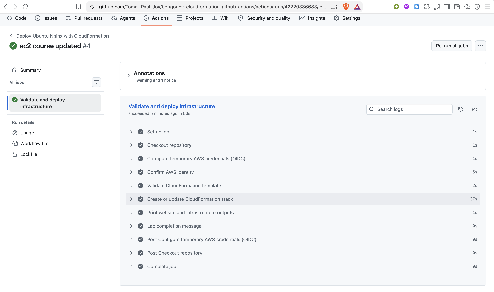

# Automating AWS Infrastructure Deployment with GitHub Actions and CloudFormation


This repository contains my **bongoDev DevOps homework**. The goal was to automate the deployment of an Ubuntu 24.04 LTS EC2 instance running an Nginx website by connecting **GitHub Actions** with **AWS CloudFormation**.

Instead of manually creating or updating the infrastructure from the AWS Console, I used a Git-based workflow. A push to the `main` branch triggers GitHub Actions, which authenticates to AWS through **OpenID Connect (OIDC)**, validates the CloudFormation template, and creates or updates the stack.

> **Project status:** The repository contains evidence of the initial deployment, a subsequent update, successful GitHub Actions runs, and AWS stack cleanup.

---

## Table of Contents

- [Objectives](#objectives)
- [Architecture](#architecture)
- [Technologies and Services](#technologies-and-services)
- [Repository Structure](#repository-structure)
- [AWS Infrastructure](#aws-infrastructure)
- [How the CI/CD Pipeline Works](#how-the-cicd-pipeline-works)
- [GitHub and AWS OIDC Configuration](#github-and-aws-oidc-configuration)
- [Deployment Procedure](#deployment-procedure)
- [Update Demonstration](#update-demonstration)
- [Verification and Results](#verification-and-results)
- [Homework Questions and Answers](#homework-questions-and-answers)
- [Security and Cost Considerations](#security-and-cost-considerations)
- [Cleanup](#cleanup)
- [Screenshots and Evidence](#screenshots-and-evidence)
- [Troubleshooting Notes](#troubleshooting-notes)
- [References](#references)

---

## Objectives

The main objectives of this homework were to:

1. Store infrastructure code in a GitHub repository.
2. Use AWS CloudFormation to define infrastructure as code (IaC).
3. Configure GitHub Actions to automate infrastructure deployment.
4. Establish secure GitHub-to-AWS authentication using OIDC.
5. Deploy an Ubuntu 24.04 LTS EC2 instance and install Nginx automatically.
6. Verify that a later Git push updates the existing CloudFormation stack.
7. Capture deployment evidence and delete the AWS resources after completing the lab.

## Architecture

```text
Developer machine
(VS Code / Terminal)
        |
        | git add, git commit, git push
        v
GitHub repository (main)
        |
        | Push changes to cloudformation.yaml
        | or .github/workflows/deploy.yml
        v
GitHub Actions
        |
        | 1. Checkout repository
        | 2. Request GitHub OIDC token
        | 3. Assume AWS IAM role
        | 4. Validate CloudFormation template
        | 5. Create or update CloudFormation stack
        v
AWS CloudFormation
        |
        +--> VPC
        +--> Public subnet
        +--> Internet Gateway and route table
        +--> Security group
        +--> Ubuntu 24.04 EC2 instance
                    |
                    | EC2 User Data
                    | installs and starts Nginx
                    v
              Nginx web server
              "Hello from bongoDev!"
```

**Deployment flow:** Git push → GitHub Actions → OIDC authentication → CloudFormation → AWS infrastructure.

## Technologies and Services

| Technology / Service | Purpose |
|---|---|
| Git | Version control |
| GitHub | Source-code hosting |
| GitHub Actions | CI/CD automation |
| AWS IAM | Identity and permission management |
| AWS IAM OIDC Identity Provider | Federated authentication from GitHub |
| AWS Security Token Service (STS) | Issues temporary credentials after role assumption |
| AWS CloudFormation | Infrastructure as Code |
| Amazon EC2 | Hosts the Ubuntu server |
| Amazon VPC | Provides the virtual network |
| Amazon SSM Parameter Store | Supplies the current Ubuntu AMI ID |
| Ubuntu 24.04 LTS | Operating system |
| Nginx | Web server |
| YAML / JSON | Infrastructure, workflow, and IAM configuration |

## Repository Structure

```text
bongodev-cloudformation-github-actions/
│
├── .github/
│   └── workflows/
│       └── deploy.yml
│
├── docs/
│   └── student-submission-checklist.md
│
├── iam/
│   ├── deployment-policy-lab.json
│   ├── trust-policy-legacy-repos.json
│   └── trust-policy-new-repos-2026.json
│
├── screenshots/
│   ├── 01_Github_Owner_Repo_Ids.png
│   ├── 02_add_identity_provider.png
│   ├── 03_identity_provider_created.png
│   ├── 04_bongodev-github-iac-lab-policy_created.png
│   ├── 05_a_role_GitHub_Actions_can_assume.png
│   ├── 06_bongodev_github_iac_lab_policy_to_role.png
│   ├── 07_setting_role_name.png
│   ├── 08_edit_trust_policy.png
│   ├── 09_role_summary_ARN.png
│   ├── 10_configure_repo_var_Github.png
│   ├── 11_github_worked__successfully.png
│   ├── 12_cloudformation_dev_success.png
│   ├── 13_cloudformation_dev_outputs.png
│   ├── 14_cloudformatioin_dev_resources.png
│   ├── 15_cloudformation_dev_websight.png
│   ├── 16_cloudformation_test_success.png
│   ├── 17_cloudformation_test_outputs.png
│   ├── 18_cloudformation_test_resources.png
│   ├── 19_cloudformation_test_websight.png
│   ├── 20_ec2_tag_updated.png
│   ├── 21_all_github_actions.png
│   ├── 22_github_actions_deployment_success.png
│   └── 23_stacks_are_deleted.png
│
├── cloudformation.yaml
├── README.md
└── .gitignore
```

The screenshot filenames above follow the names shown in the repository. If any filename in your actual `screenshots/` directory differs, update the corresponding name before using it in a Markdown image link.

### Important files

- **`cloudformation.yaml`** — describes the AWS network, security group, EC2 instance, Nginx bootstrap script, and stack outputs.
- **`.github/workflows/deploy.yml`** — defines the GitHub Actions deployment pipeline.
- **`iam/deployment-policy-lab.json`** — contains the IAM permissions used by the classroom deployment role.
- **`iam/trust-policy-new-repos-2026.json`** — trust policy for repositories using GitHub's newer immutable OIDC subject format.
- **`iam/trust-policy-legacy-repos.json`** — alternative trust policy for older repositories.
- **`docs/student-submission-checklist.md`** — checklist of the homework evidence to submit.
- **`screenshots/`** — records the IAM/OIDC setup, deployments, verification, update, and cleanup.

## AWS Infrastructure

The CloudFormation template provisions the following resources:

| Resource | Configuration / Purpose |
|---|---|
| VPC | `10.42.0.0/16` |
| Public subnet | `10.42.1.0/24` |
| Internet Gateway | Provides internet connectivity for the public subnet |
| Route table | Routes public-subnet internet traffic through the Internet Gateway |
| Security group | Allows inbound HTTP traffic on TCP port `80`; no inbound SSH rule is configured |
| EC2 instance | Ubuntu 24.04 LTS, instance type `t3.micro` |
| EC2 User Data | Installs and starts Nginx automatically |
| Ubuntu AMI | Retrieved from Canonical's public AWS SSM parameter |
| CloudFormation outputs | Website URL, instance ID, public IP address, and VPC ID |

The demo website is served over HTTP on port 80. It displays:

```text
Hello from bongoDev!
Infrastructure as Code is working!
Ubuntu 24.04 LTS + Nginx + AWS CloudFormation
Environment: dev
```

The template uses the current Ubuntu AMI published through Canonical's public SSM parameter. Therefore, the exact AMI can vary between deployments and AWS Regions.

## How the CI/CD Pipeline Works

The workflow is stored at:

```text
.github/workflows/deploy.yml
```

It is configured to run when changes are pushed to `main` that affect:

- `cloudformation.yaml`
- `.github/workflows/deploy.yml`

It also supports a manual run through `workflow_dispatch`.

The workflow performs these tasks:

1. **Checkout:** checks out the repository contents on a GitHub-hosted Ubuntu runner.
2. **OIDC authentication:** obtains a GitHub OIDC token and assumes the configured AWS IAM role.
3. **Identity verification:** checks the AWS identity available to the runner.
4. **Template validation:** runs `aws cloudformation validate-template`.
5. **Deployment:** runs `aws cloudformation deploy` to create or update the stack.
6. **Output display:** prints the CloudFormation stack outputs, including the website URL.

The deployment command follows this pattern:

```bash
aws cloudformation deploy \
  --template-file cloudformation.yaml \
  --stack-name "$STACK_NAME" \
  --parameter-overrides Environment=dev \
  --region "$AWS_REGION" \
  --no-fail-on-empty-changeset
```

The first successful deployment creates the stack. Later deployments update that same stack when the template has changes. If there are no changes, `--no-fail-on-empty-changeset` allows the workflow to finish successfully.

**Note:** A README-only push does not trigger the deployment when the workflow's `paths` filter is limited to the template and workflow files.

## GitHub and AWS OIDC Configuration

I configured GitHub Actions to access AWS without storing permanent AWS access keys in GitHub.

The setup involved:

1. Finding the GitHub owner ID and repository ID.
2. Creating or reusing the AWS IAM identity provider:
   - Provider URL: `https://token.actions.githubusercontent.com`
   - Audience: `sts.amazonaws.com`
3. Creating the classroom IAM deployment policy.
4. Creating the IAM role `bongodev-github-iac-deploy-role`.
5. Attaching the deployment policy to the role.
6. Configuring the role's trust relationship to allow the intended GitHub repository and `main` branch to assume it.
7. Adding the following repository variables under **Settings → Secrets and variables → Actions → Variables**:

| Variable | Value |
|---|---|
| `AWS_ROLE_ARN` | ARN of the IAM deployment role |
| `AWS_REGION` | `us-west-2` |

For a repository created under GitHub's newer immutable OIDC subject format, the trust policy must match the repository's numeric owner ID and repository ID as well as its branch. The trust policy must not be opened to every repository or branch.

**No `AWS_ACCESS_KEY_ID` or `AWS_SECRET_ACCESS_KEY` GitHub secrets are required for this OIDC-based workflow.**

## Deployment Procedure

The following is the overall procedure used for the homework.

### 1. Prepare the repository

Create the GitHub repository:

```text
bongodev-cloudformation-github-actions
```

Use `main` as the working branch and place the CloudFormation template, workflow, IAM policies, documentation, and screenshots in the repository.

### 2. Configure AWS IAM

Create or reuse the GitHub OIDC identity provider, create the deployment policy and role, and update the trust policy with the correct AWS account and GitHub repository identity values.

### 3. Configure GitHub repository variables

Add `AWS_ROLE_ARN` and `AWS_REGION` in the repository's Actions variables.

### 4. Push the project

From the project root:

```bash
git init
git branch -M main
git add .
git commit -m "Add IaC and GitHub Actions automation"
git remote add origin https://github.com/Tomal-Paul-Joy/bongodev-cloudformation-github-actions.git
git push -u origin main
```

If the repository already has a remote, check it with `git remote -v` rather than adding it again.

### 5. Monitor the deployment

Open the repository's **Actions** tab and inspect the latest run. A successful run should complete the validation and deployment steps and print the CloudFormation outputs.

### 6. Verify the AWS resources and website

In the AWS Console, select the configured Region and open CloudFormation. Check the stack's status, Resources, and Outputs. Open the `WebsiteURL` output in a browser using HTTP and verify the Nginx page.

## Update Demonstration

To demonstrate that a later Git push updates the infrastructure, the homework asks for a harmless EC2 tag change.

Original tag:

```yaml
- Key: Course
  Value: bongoDev-DevOps
```

Updated tag:

```yaml
- Key: Course
  Value: bongoDev-DevOps-Homework-V2
```

Commit and push the change:

```bash
git add cloudformation.yaml
git commit -m "Update EC2 Course tag through IaC"
git push origin main
```

Then verify:

- A new GitHub Actions run starts.
- CloudFormation updates the existing stack.
- The stack reaches `UPDATE_COMPLETE`.
- The EC2 instance has the updated `Course` tag.
- The instance ID remains the same for this tag-only update.

This demonstrates that CloudFormation reconciles the existing stack with the updated template rather than creating a new stack for every push.

## Verification and Results

The repository's evidence folder documents the following stages:

- GitHub owner and repository identity lookup.
- AWS GitHub OIDC identity provider creation.
- IAM deployment policy and role configuration.
- IAM trust-policy configuration.
- GitHub Actions repository-variable configuration.
- Successful GitHub Actions deployment.
- CloudFormation development deployment and outputs.
- CloudFormation resource verification and live website.
- Additional test-environment deployment evidence.
- EC2 tag update and subsequent GitHub Actions run.
- Successful deployment evidence and stack deletion.

The screenshots are stored in the `screenshots/` directory. See [Screenshots and Evidence](#screenshots-and-evidence).

## Homework Questions and Answers

### 1. What is the difference between GitHub Actions and AWS CloudFormation?

**GitHub Actions** is the automation and CI/CD service. It runs the workflow when a relevant change is pushed and executes the deployment commands.

**AWS CloudFormation** is the Infrastructure as Code service. It reads the template and creates, updates, or deletes the AWS resources described in it.

In short, GitHub Actions runs the automation; CloudFormation manages the infrastructure.

### 2. Why can a Git push deploy infrastructure without anyone logging into the AWS Console?

The GitHub Actions workflow starts automatically after a matching push to `main`. The workflow authenticates to AWS through OIDC, assumes the configured IAM role, and runs the CloudFormation deployment command. Therefore, a person does not need to log in to the AWS Console for each deployment.

### 3. What does OIDC do, and why is it safer than committing AWS access keys?

OpenID Connect allows GitHub Actions to prove its identity to AWS. AWS checks the IAM role's trust policy and, if the conditions match, issues temporary credentials.

This is safer than storing long-lived AWS access keys in GitHub because the workflow does not need permanent credentials saved in the repository or GitHub secrets. The role trust policy can also restrict access to the intended repository and branch.

### 4. On a second push, why is the existing stack updated instead of creating a new one?

The workflow always deploys using the same CloudFormation stack name. CloudFormation creates that stack if it does not exist; if it already exists, CloudFormation compares the template with the deployed stack and applies the required changes.

### 5. Does CloudFormation stack creation being complete always mean Nginx is ready?

No. `CREATE_COMPLETE` means CloudFormation has completed the resource provisioning operations. The EC2 User Data script may still be installing packages and starting Nginx. The website may need additional time before it becomes available.

### 6. Why does this homework update the EC2 tag instead of changing the webpage HTML?

The tag change is a simple infrastructure-only change that demonstrates a CloudFormation stack update without changing the application bootstrap process. EC2 User Data normally runs during the instance's initial launch; changing the User Data script in the template does not automatically rerun it on an existing instance.

For real application updates, a separate application deployment mechanism—such as an application pipeline or Systems Manager automation—is more appropriate.

### 7. What should happen to AWS resources after completing the assignment?

The CloudFormation stack and the resources it created should be deleted after all required evidence has been captured. The EC2 instance should be terminated and the lab's networking resources should be removed. The dedicated classroom IAM role and policy can also be deleted when no longer needed, while a shared OIDC provider should be retained if another project uses it.

## Security and Cost Considerations

- This homework creates real AWS resources that may incur charges, including EC2, EBS storage, and public IPv4 address usage.
- Delete the CloudFormation stack after capturing the required evidence.
- Do not commit AWS access keys, secret keys, private keys, or other credentials.
- Use OIDC and a narrowly scoped IAM trust relationship for GitHub Actions.
- The classroom deployment policy uses broad resource permissions for learning convenience. It is **not a production-ready least-privilege policy**.
- The demo website uses public HTTP port 80 and is not intended for production.
- No inbound SSH access is configured in the lab security group.
- Do not use this classroom setup in an employer's production AWS account.

## Cleanup

After collecting the screenshots and other required evidence:

1. Open **AWS CloudFormation → Stacks** in the deployment Region.
2. Select `bongodev-github-iac-dev`.
3. Choose **Delete** and confirm.
4. Wait for the stack to be removed or reach `DELETE_COMPLETE` in the deleted-stack history.
5. Check EC2 and confirm that the lab instance is terminated.
6. Confirm that the VPC and networking resources created by the stack have been removed.
7. Review any `DELETE_FAILED` events and resolve them if necessary.
8. When the lab is no longer needed, remove the dedicated IAM role and classroom policy. Do not remove an OIDC provider that is shared by another project.

An authorized local AWS CLI identity can also delete the stack:

```bash
aws cloudformation delete-stack \
  --stack-name bongodev-github-iac-dev \
  --region us-west-2

aws cloudformation wait stack-delete-complete \
  --stack-name bongodev-github-iac-dev \
  --region us-west-2
```

Do not push another deployment-triggering template or workflow change after cleanup unless you intend to recreate the stack. Disable the workflow first if you need to continue editing the repository without deploying.

## Screenshots and Evidence

All evidence is stored in [`screenshots/`](screenshots/).

| Screenshot | Evidence |
|---|---|
| `01_Github_Owner_Repo_Ids.png` | GitHub owner and repository IDs |
| `02_add_identity_provider.png` – `03_identity_provider_created.png` | Adding and creating the GitHub OIDC provider |
| `04_bongodev-github-iac-lab-policy_created.png` | IAM deployment policy |
| `05_a_role_GitHub_Actions_can_assume.png` – `09_role_summary_ARN.png` | IAM role, attached policy, trust relationship, and role ARN |
| `10_configure_repo_var_Github.png` | GitHub Actions repository variables |
| `11_github_worked__successfully.png` | GitHub Actions workflow execution |
| `12_cloudformation_dev_success.png` – `15_cloudformation_dev_websight.png` | Development stack, outputs, resources, and website |
| `16_cloudformation_test_success.png` – `19_cloudformation_test_websight.png` | Test-environment stack, outputs, resources, and website |
| `20_ec2_tag_updated.png` | Updated EC2 Course tag |
| `21_all_github_actions.png` – `22_github_actions_deployment_success.png` | GitHub Actions runs and successful deployment |
| `23_stacks_are_deleted.png` | AWS stack cleanup evidence |

To display an individual screenshot directly in this README, use a relative Markdown image link. For example:

```markdown

```

## Troubleshooting Notes

| Problem | What to check |
|---|---|
| `sts:AssumeRoleWithWebIdentity` is denied | Check the OIDC provider, audience, role ARN, and exact `sub` value in the IAM trust policy. Confirm the owner ID, repository ID, repository name, and branch. |
| `AccessDenied` for AWS services | Confirm the deployment policy is attached to the role and inspect the denied action. Check account restrictions, permission boundaries, SCPs, quotas, and Region restrictions. |
| `AWS_ROLE_ARN` or Region is missing | Check the exact repository variable names: `AWS_ROLE_ARN` and `AWS_REGION`. |
| Workflow does not start | Confirm the workflow path is `.github/workflows/deploy.yml`, the branch is `main`, Actions are enabled, and the changed file matches the workflow's path filter. |
| CloudFormation rolls back | Inspect the first failing resource in the CloudFormation Events tab and fix the underlying error before retrying. |
| Website is unavailable | Use the HTTP URL from stack Outputs; check EC2 status, public IP, port 80 ingress, subnet routing, and User Data completion. |
| No changes are to be performed | This is expected when the template has no changes. Change the EC2 `Course` tag to demonstrate an actual update. |

## References

- [GitHub Docs — Configuring OpenID Connect in Amazon Web Services](https://docs.github.com/en/actions/how-tos/secure-your-work/security-harden-deployments/oidc-in-aws)
- [GitHub Docs — OpenID Connect reference](https://docs.github.com/en/actions/reference/security/oidc)
- [AWS — Configure AWS credentials for GitHub Actions](https://github.com/aws-actions/configure-aws-credentials)
- [AWS CLI — `cloudformation deploy`](https://docs.aws.amazon.com/cli/latest/reference/cloudformation/deploy.html)
- [AWS CloudFormation User Guide](https://docs.aws.amazon.com/AWSCloudFormation/latest/UserGuide/Welcome.html)
- [AWS — EC2 instance user data](https://docs.aws.amazon.com/AWSEC2/latest/UserGuide/user-data.html)
- [Canonical — Ubuntu on AWS](https://ubuntu.com/server/docs/cloud-images/amazon-ec2/)

---

**Completed the task finally **


